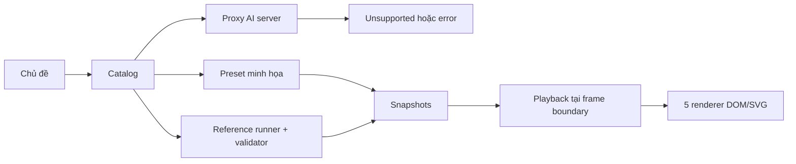

# TechViz Sandbox

Trực quan hóa thuật toán và luồng hệ thống bằng React, TypeScript, Vite và năm renderer DOM/SVG. Kế hoạch và bằng chứng nằm trong [Master Plan](docs/plans/MASTER_PLAN.md) và [Progress](docs/plans/PROGRESS.md).

Ứng dụng phân biệt nguồn dữ liệu:

- 11 preset giữ nguyên snapshots, được ghi nhãn **minh họa biên soạn**, chưa xác minh toàn bộ claim.
- Nhập `Bubble pass [3,1,2]` để chạy một lượt Bubble Sort với 2–20 số. Runner và validator kiểm compare/swap, bảo toàn giá trị và max về cuối; không khẳng định toàn mảng đã sort.
- Chủ đề AI chưa có capability được duyệt trả unsupported/error và giữ kịch bản đang xem. JSON hợp lệ không tự được coi là mô phỏng đúng.



## Chạy local

Đã kiểm với Node.js 24.15.0. Bộ test trực tiếp import TypeScript bằng Node.

```sh
npm ci
npm run dev
npm run build
npm run preview -- --host 127.0.0.1 --port 3000
```

Vite dev/preview phục vụ frontend. Pages Function cần Cloudflare runtime; preset và runner local hoạt động mà không cần AI key.

Playback có Next/Back/Seek/Reset, speed và phím ArrowLeft/ArrowRight khi không nhập văn bản. Pause hiển thị snapshot tại frame boundary; reduced motion tắt chuyển động. Timeline dài cuộn riêng. Grid dùng snapshot trong playback; chỉnh tường chuyển sang solver tương tác, seek/reset quay về snapshot.

## Kiểm thử

```sh
npm test
npm run check:fixtures
npm run check:ai
npm run test:e2e
```

`test:e2e` build, mở preview riêng rồi chạy regression 11 preset, AI negatives, fake playback clock, capability, keyboard/mobile/reduced motion và ma trận Chromium/Firefox/WebKit. Cài các browser Playwright nếu máy chưa có:

```sh
npx playwright install chromium firefox webkit
```

Artifact mới lưu ở `docs/plans/phase6/`; không ghi đè baseline P0. Benchmark so production với Git `991ea6c` bằng `node docs/plans/phase4/measure.mjs`. Số đo seek không đại diện animation FPS hay mọi scene dày.

## Cloudflare Pages và AI

Frontend build command `npm run build`, output `dist`; backend là `functions/api/groq.ts`. Secret duy nhất cho provider là **GROQ_API_KEY ở server**. Không đặt khóa trong biến `VITE_*`, source hoặc bundle.

Browser gửi `{query}`; server sở hữu prompt/model, token budget, giới hạn body và timeout. Limiter trong code chỉ áp dụng từng isolate; cần rate rule tại edge trước public AI rollout. Cấu hình `vercel.json` hiện tại chỉ là SPA và không triển khai Cloudflare Pages Function.

Staging được cung cấp: [techvizbyninhnv.pages.dev](https://techvizbyninhnv.pages.dev/). Kiểm ngày 2026-10-22 cho thấy release cũ, CORS wildcard và một chuỗi khớp định dạng Groq key trong JavaScript công khai. **Cần thu hồi/rotate khóa cũ tại Groq, bỏ biến VITE chứa khóa và deploy bản đã kiểm.** [Báo cáo](docs/plans/phase5/staging-results.json) không lưu khóa. Redeploy không tự thu hồi khóa đã lộ.

`node docs/plans/phase5/staging.mjs` kiểm page/assets/OPTIONS, không gọi provider. Sau release mới cần kiểm request/timeout/rate rule trong staging thật rồi mới đóng G2.

## Nghiệm thu còn cần kết quả thực

Code và kiểm thử tự động không thay thế human review nội dung, thử screen reader thực tế, pilot 5 người học, contributor trial hoặc diễn tập rollback vận hành. Phiếu review, hướng dẫn pilot và playbook đã có trong `docs/plans/phase5/`, `phase6/`, `phase7/`; trạng thái thực theo Progress.
