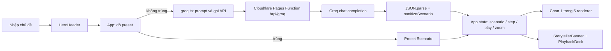
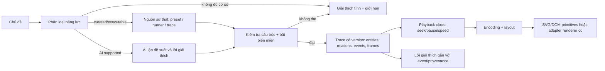

# TechViz — Master Implementation Plan

> Ngày lập: 2026-10-21. Trạng thái: P0 có baseline; P1 có fixture và rubric bản nháp, còn chờ review/gate. Tài liệu này là bản đồ dài hạn; trước mỗi phase, agent thực hiện phải đọc lại source hiện hành, chốt hợp đồng và chia task thành diff nhỏ với test cụ thể. Theo dõi tại [PROGRESS.md](PROGRESS.md).

## 1. Mục tiêu và nguyên tắc nghiệm thu

Người học nhập một thuật toán, công nghệ hoặc khái niệm khoa học máy tính và nhận được giải thích ngắn cùng trực quan hóa **đúng với cơ chế đang giải thích**. Giá trị cốt lõi là engine biểu diễn, kiểm chứng và chạy lại được nhiều loại diễn tiến; số lượng chủ đề hay hiệu ứng không phải chỉ tiêu thành công.

Một chủ đề chỉ được nhận nhãn *mô phỏng* khi có nguồn hành vi đủ tin cậy, trạng thái nhất quán và các bước có thể kiểm chứng. Trường hợp chưa đủ bằng chứng phải hiện giải thích tĩnh hoặc “chưa hỗ trợ mô phỏng”, nói rõ giới hạn. Không tạo chuyển động, Big-O, trạng thái hoặc quan hệ chỉ để lấp chỗ trống. Giữ preset và năm renderer hiện tại hoạt động trong suốt migration; thay từng đường dữ liệu sau khi có kiểm chứng tương đương. Không thêm chức năng so sánh thuật toán, tùy chỉnh nâng cao hay tăng danh mục chủ đề để đo tiến độ engine.

Đây là kế hoạch kiến trúc, **không phải đặc tả đóng băng toàn bộ API**. Các con số đánh giá ở mục 6 là ngưỡng đề xuất cho pilot và phải chốt từ baseline P0/P1. Mỗi decision gate có quyền giữ kiến trúc cũ hoặc đổi hướng dựa trên kết quả POC.

## 2. Bằng chứng hiện trạng

### 2.1 Luồng thực tế

- Điểm vào: `src/components/HeroHeader.tsx:54-57,116-123`; tìm preset gần đúng và gọi AI: `src/App.tsx:167-208`. Preset được chọn thẳng vào state, còn kịch bản AI đi qua `generateScenarioWithGroq`; kịch bản tạo mới chỉ ở state phiên hiện tại (`src/App.tsx:26-30`).
- Hợp đồng hiện tại: `src/types/simulation.ts:94-163` cho phép `rendererType` tùy chọn, `visualData` và nhiều biến trạng thái kiểu `any`; năm loại là `flow-graph`, `array-pointer`, `grid-path`, `swarm-2d`, `tree-graph`. TypeScript không xác thực JSON runtime.
- `src/services/groq.ts:50-155` yêu cầu LLM tự phân loại vào một trong năm loại, tự viết 5–8 bước, kiến thức và trạng thái. `sanitizeScenario` (`:158-437`) vừa chuẩn hóa vừa **tự sáng tác dữ liệu ngữ nghĩa** khi thiếu: Big-O chung (`:176-183`), node (`:193-200`), bước (`:224-234`), array (`:266-276`), grid (`:280-289`), swarm (`:303-317`), tree (`:330-343`), packet (`:364-377`). Điều này có thể biến một chủ đề không phù hợp thành hình trông hợp lệ.
- Proxy `functions/api/groq.ts:19-123` giữ khóa ở server nhưng chuyển tiếp các tham số request như model/messages/temperature/response format, thử nhiều model; chưa có hạn mức, giới hạn kích thước hoặc timeout server được thể hiện trong source. `src/services/groq.ts:448-544` còn có nhánh khóa `VITE_GROQ_API_KEY` trên browser; biến `VITE_` được đóng vào bundle. `vercel.json` chỉ khai báo SPA rewrite, trong khi function viết cho Cloudflare Pages: deployment cần xác minh thực tế, không suy từ source rằng endpoint luôn tồn tại.
- `src/App.tsx:219-290,550-571` điều phối playback và route renderer. Cổng array chỉ nhìn `arrayData.array` dù renderer cũng nhận `visualData.array` (`src/components/ArrayPointerRenderer.tsx:60-89`); khi dữ liệu không khớp, App có thể đưa scenario array sang flow. `steps` rỗng làm `currentStep` không tồn tại, trong khi nhiều thành phần giả định có step.
- `src/components/GridPathRenderer.tsx:43-44,68-113` dùng cấu hình grid mặc định, không nhận `defaultGridConfig` của scenario. Renderer này chứa cả solver (`:115-239`) và chuyển sang kết quả solver khi `stepIndex === 4` (`:249-267`), khiến ảnh có thể không phản ánh snapshot. `src/components/Swarm2DRenderer.tsx:41-54` suy “best” theo khoảng cách khi thiếu cờ fitness; `src/data/geneticAlgorithmPreset.ts:3-28` trộn ý GA và PSO. `src/components/TreeGraphRenderer.tsx:44-89` xếp node theo thứ tự level, chưa bảo toàn bố cục cây phức tạp. `src/components/FlowGraphRenderer.tsx:133-162,215-225` đo liên kết từ DOM và có thể bỏ packet khi node tham chiếu không tồn tại; zoom/pan và resize cần kiểm thử trực quan. Một số chuyển động lặp tự chạy độc lập với trạng thái pause (`FlowGraphRenderer.tsx:396-415`).
- `src/components/StorytellerBanner.tsx:175-177` hiển thị pseudocode chung khi thiếu `logicCode`; dễ gây hiểu rằng đó là logic thật. Playback và âm thanh đã có (`src/components/PlaybackDock.tsx`, `src/utils/audio.ts`) và nên được tái sử dụng, nhưng đồng hồ animation phải thống nhất với trạng thái pause/seek.
- `README.md` mô tả năm engine, preset và AI nhưng còn nhắc `ApiKeyModal.tsx` không tồn tại. `docs/superpowers/plans/2026-10-21-techviz-upgrade.md` là kế hoạch nâng cấp trước đây để bổ sung năm renderer, không phải kế hoạch engine dài hạn. `package.json` có `dev/build/preview`, không có test script; repository hiện không có file test. Không có `graphify-out/graph.json` để truy vấn.

### 2.2 Kết quả thực nghiệm và giới hạn

Ngày 2026-10-21 đã chạy `npm run build`: dừng trước compile với `'tsc' is not recognized as an internal or external command` (thiếu `node_modules/.bin/tsc`; cũng không có lockfile). Đây là lỗi môi trường phụ thuộc, **không chứng minh code biên dịch lỗi**. Chưa có browser smoke test hay phép đo FPS/khả năng đọc; các nhận định renderer phía trên là audit source. P0 phải tái tạo môi trường trước khi coi bất kỳ baseline nào là kết quả thực nghiệm.

### 2.3 Giữ, cải tiến, thiết kế lại, loại bỏ có điều kiện

| Quyết định | Thành phần | Lý do / điều kiện |
|---|---|---|
| Giữ | React/Vite, preset, điều khiển step, năm renderer, UI hiện có | Đã có luồng sử dụng thực; dùng làm baseline và adapter, chưa có bằng chứng cần thay toàn bộ. |
| Cải tiến | Route renderer, playback clock, bố cục graph/tree/grid, nội dung giải thích | Có các điểm lệch giữa dữ liệu và hiển thị; sửa bằng contract và regression case trước khi trừu tượng hóa. |
| Thiết kế lại dần | Ranh giới AI → dữ liệu kiểm chứng → renderer; `sanitizeScenario` | “Sanitize” hiện tự sinh nội dung không có bằng chứng; cần phân biệt chuyển đổi cú pháp với xác thực ngữ nghĩa. |
| Loại bỏ sau migration | Fallback ngữ nghĩa bịa dữ liệu, pseudocode chung, nhánh browser key | Chỉ bỏ sau khi đường thay thế báo rõ trạng thái unsupported/error và test regression đạt. |

## 3. Cơ sở tham khảo và suy luận áp dụng

| Nguồn gốc | Điều quan sát được | Bài học cho TechViz / giới hạn |
|---|---|---|
| [VisuAlgo chính thức](https://visualgo.net/en/) | Step, input người học và giải thích gắn với module thuật toán cụ thể. | Giữ bước và tương tác học tập; việc nhiều module riêng **không** chứng minh nên viết renderer cho mọi chủ đề. |
| [Algorithm Visualizer](https://github.com/algorithm-visualizer/algorithm-visualizer/blob/master/README.md), [tracers.js](https://algorithm-visualizer.github.io/tracers.js/) | Tracer phát lệnh quan sát từ code, viewer diễn giải lệnh. | Tách *nguồn sự kiện có thể đối chiếu* khỏi phần vẽ. Instrumentation mạnh cho thuật toán chạy được; không áp dụng máy móc cho công nghệ mô tả định tính. |
| [JSAV docs](https://jsav.io/), [repository](https://github.com/vkaravir/JSAV) | Cấu trúc array/graph/tree, primitive, message, slideshow và extension. | Tái sử dụng primitive và playback; API/stack cũ không phải lý do để đổi dependency. |
| [Hello Algo](https://github.com/krahets/hello-algo) | Nội dung giải thích, hoạt hình và code nhiều ngôn ngữ được biên soạn. | Curated reference có giá trị để chấm độ đúng và clarity; không đồng nhất code mẫu với bằng chứng chạy của mọi scene. |
| [Munzner 2009](https://pubmed.ncbi.nlm.nih.gov/19834155/) | Bốn tầng: domain, trừu tượng dữ liệu/tác vụ, encoding/tương tác, thuật toán triển khai. | Đặt gate ở từng tầng; renderer đẹp không sửa được một mô hình kiến thức sai. Đây là áp dụng thiết kế, không phải benchmark trực tiếp của TechViz. |
| [Tversky et al. 2002](https://www.tc.columbia.edu/faculty/bt2158/faculty-profile/files/_Morrison_Betrancourt_AnimationCanitfacilitate.pdf), [Mayer & Moreno 2003](https://carpentries.github.io/instructor-training/files/papers/mayer-reduce-cognitive-load-2003.pdf) | Animation có thể khó nắm nếu quá nhanh/phức tạp; chia đoạn và giảm tải nhận thức có ích. | Ưu tiên bước rời rạc, pause/seek và tín hiệu thị giác có ý nghĩa; không coi thêm motion là tự động tăng hiệu quả học. |
| [Naps et al.](https://citeseerx.ist.psu.edu/document?doi=47e7044f89fa1b4695f3ac7b916e77b538d09154&repid=rep1&type=pdf) | Mức tham gia của người học và cách đánh giá ảnh hưởng của AV quan trọng. | Đo cả hiểu đúng sau khi xem, không chỉ độ mượt hoặc ấn tượng. |
| [Vega](https://vega.github.io/vega/), [D3 data join](https://github.com/d3/d3/blob/main/docs/d3-selection/joining.md) | Grammar/marks và data binding có thể tạo nhiều hình từ ít primitive. | Thử mô hình khai báo nhỏ trong POC; Vega thiên về đồ họa dữ liệu, chưa chắc diễn tả tốt packet/thuật toán theo thời gian. D3 là nguồn kỹ thuật, chưa quyết định dependency. |
| [MDN Canvas](https://developer.mozilla.org/en-US/docs/Web/HTML/Reference/Elements/canvas), [W3C WCAG 2.2.2](https://www.w3.org/WAI/WCAG22/Understanding/pause-stop-hide) | Canvas cần lớp ngữ nghĩa riêng; nội dung động tự chạy cần cơ chế dừng trong điều kiện WCAG nêu. | Ưu tiên DOM/SVG khi quy mô vừa; chỉ cân nhắc Canvas sau benchmark, giữ mô tả text, pause và reduced motion. |

Không sao chép nội dung/hình của nguồn tham khảo. Bằng chứng học thuật định hướng phép đo; các ngưỡng sản phẩm phải được thử với người học TechViz.

## 4. Lựa chọn kiến trúc

### 4.1 Các phương án cần đối chứng ở P2

| Phương án | Điểm mạnh | Điểm yếu/rủi ro | Kết luận hiện tại |
|---|---|---|---|
| A. Giữ schema và mở rộng renderer theo chủ đề | Diff nhỏ, tận dụng code hiện có | Nhanh tăng nhánh và fallback, khó kiểm chứng xuyên chủ đề | Baseline đối chứng, không chọn làm đích mặc định. |
| B. Sự kiện miền + frame trạng thái + primitive/scene hẹp; renderer cũ qua adapter | Traceable, replay được, tái sử dụng encoding theo nhóm; dễ xác thực từng biến đổi | Cần thiết kế hợp đồng/version, migration và layout động | **Giả thuyết ưu tiên để POC**, chưa phê duyệt rewrite. |
| C. Dùng visualization grammar/library tổng quát | Có layout/marks và hệ sinh thái | Có thể ép mô phỏng thuật toán vào grammar biểu đồ; runtime/dependency lớn | POC so sánh nếu B lộ thiếu năng lực. |
| D. Sinh SVG/Canvas trực tiếp bằng AI | Linh hoạt bề mặt | Khó xác thực semantics, event và an toàn; khó replay | Không dùng cho nội dung được gắn nhãn mô phỏng chính xác. |

Không mặc định scene graph, DSL hoặc thư viện cụ thể. Chỉ giữ những lớp được POC chứng minh làm giảm lặp hoặc tăng khả năng kiểm chứng. Nếu primitive nhỏ không tái sử dụng được cho ít nhất hai nhóm thử, giữ family renderer và chuẩn hóa ranh giới dữ liệu trước.

### 4.2 Kiến trúc mục tiêu đề xuất để thử

**Nguồn dữ liệu:** Với thuật toán chạy được, tạo trace từ reference runner nhỏ, deterministic, nhập input cụ thể và lưu snapshot/oracle; instrumentation hoặc adapter chuyển event có nghĩa như compare, swap, visit, enqueue, send/receive. Với công nghệ hệ thống, dùng mô hình trạng thái/quan hệ biên soạn và được chuyên gia duyệt; phân biệt “minh họa một luồng hợp lệ” với kết luận tổng quát. AI có thể chọn capability, soạn lời giải thích và đề xuất trace theo hợp đồng; AI **không** là oracle về thuật toán hoặc cơ chế. Topic chưa có runner/reference/invariant thích hợp đi theo trạng thái static/unsupported.

**IR tối thiểu cần kiểm nghiệm:** `scenarioVersion`, `topic`, `status` (`verified-simulation`, `illustrative`, `static`, `unsupported`), `source/provenance`, `entities` với ID ổn định và loại có nghĩa, `relations` có đầu-cuối hợp lệ, `initialState`, `events` có thứ tự và nguyên nhân, `frames` hoặc reducer tạo frame, `annotations` neo vào event/entity, `encoding` chọn primitive/layout hợp lệ. Đừng đưa pixel/x-y do AI đoán vào tầng ngữ nghĩa; layout tính tọa độ và giữ ID qua step. Ví dụ primitives ứng viên: cell/bar, node, edge/packet, grid cell, pointer/marker, label, vector. Quan hệ thời gian và topology quan trọng hơn số shape. P2 quyết định event log + reducer hay snapshot thuần (hoặc hỗn hợp) bằng POC và độ dễ debug.

**Đường an toàn:** Lỗi cú pháp có thể được chuẩn hóa mà không đổi ý nghĩa (ví dụ trường alias đã công bố). Lỗi bất biến, quan hệ thiếu, tính toán mâu thuẫn, AI thiếu dữ liệu: từ chối mô phỏng, giữ phần giải thích đã xác minh nếu có; không tạo default semantic. Mọi annotation về độ phức tạp, tối ưu, path, delivery phải có nguồn hoặc validator phù hợp. API server kiểm soát model/prompt/limits; browser không mang khóa. Nội dung text AI chỉ đi qua React text rendering, không thực thi mã hoặc SVG tùy ý.

**Playback/rendering:** Một clock duy nhất quyết định frame và transition; pause đóng băng mọi motion có ngữ nghĩa, seek đưa về trạng thái xác định, speed đổi duration, reduced motion thay chuyển động bằng trạng thái rời rạc. Renderer nhận frame thuần, không tự chạy solver hay tự suy “best”. Encoding/layout riêng theo topology, primitive dùng chung giữa family; adapter cho renderer cũ tồn tại đến khi thay được bằng bằng chứng. SVG/DOM là lựa chọn đầu để thử vì dễ inspect và tạo lớp accessibility; Canvas chỉ nếu benchmark chứng minh cần thiết.

## 5. Chiến lược đánh giá và decision gates

**Bộ mẫu khóa ở P1:** ít nhất 2 case chuẩn cho mỗi family hiện tại (array/search; grid; flow; swarm; tree), 1 case chủ đề chưa hỗ trợ và các case dữ liệu rỗng, tham chiếu gãy, chu trình cây, step không nhất quán. Mỗi case ghi input, ý nghĩa mong đợi, state sau từng event, lời giải thích, nguồn tham chiếu và hạn chế. Chọn một case có thuật toán xác định để kiểm oracle, một case hệ thống để kiểm ranh giới “minh họa”. Giữ tập này cố định trong POC để tránh chọn ví dụ thuận lợi; mở rộng khi phát hiện lỗi thực.

**Đánh giá theo tầng:** (1) chuyên gia đọc đúng/sai phát biểu và mô hình miền; (2) property/invariant tests cho trace và mapping; (3) snapshot/DOM + tương tác pause/seek/resize/zoom/reduced motion; (4) đo thời gian dựng frame, số DOM node, FPS trên cấu hình ghi rõ; (5) thử người học: câu hỏi trước/sau, hiểu nhầm và thời gian hoàn thành. Không dùng ảnh đẹp thay cho câu trả lời đúng. Lỗi sai ngữ nghĩa có mức chặn phát hành dù benchmark nhanh.

**Gate G0 — sau P0/P1:** build và smoke test lặp lại được; bộ mẫu có expected trace, rubric và lỗi đã phân loại. Nếu môi trường chưa tái tạo được, không bắt đầu POC kiến trúc.

**Gate G1 — sau P2:** trên cùng **lát cắt POC đã khóa ở P2-T1**, B phải có trace đúng theo oracle/invariant, seek/pause xác định, ít hoặc bằng mức code lặp so với A, không giảm readability/accessibility; hiệu năng không kém baseline quá ngưỡng P1 chốt. Quyết định chỉ cho phép xây tiếp và kiểm toàn bộ family ở P3/P4, chưa khẳng định engine tổng quát. Nếu chưa đạt, giữ family renderer + hợp đồng xác thực và thử C có giới hạn; không phát triển schema tổng quát trước bằng chứng.

**Gate G2 — sau P4-T5 và P5-T4, trước rollout P6:** AI malformed/unsupported không được gắn nhãn mô phỏng; toàn bộ preset cũ còn dùng được qua adapter; lỗi API được biểu đạt rõ. Nếu fail, chặn rollout AI và tiếp tục preset.

**Gate G3 — trước mở rộng chủ đề:** chỉ thêm family/capability mới khi hai case độc lập chứng minh primitive/reducer hiện có hoặc extension nhỏ diễn đạt đúng và người học không hiểu nhầm. Không đếm renderer hay topic làm KPI.

## 6. Lộ trình Phase → Task

Quy ước: task tạo một đầu ra có thể review riêng; “test” bao gồm phép kiểm tài liệu/POC khi chưa sửa production. Trạng thái và dependencies chi tiết ở PROGRESS. Agent sau này phải giữ đường preset hoạt động, chạy test/build trước và sau mỗi thay đổi production, ghi kết quả thực nghiệm và cập nhật file tiến độ. File được nêu là điểm vào, không phải danh sách đóng: tác giả task phải rà callers, fixtures, exports/config hiện hành trước diff. Không tạo abstraction/dependency khi một sửa nhỏ trên boundary hiện tại đủ.

### P0 — Khôi phục baseline và khóa phạm vi

**Mục tiêu/phạm vi:** có build/smoke test lặp lại được và bản đồ hành vi hiện tại; không sửa logic sản phẩm. **Rủi ro:** môi trường local khác deployment; giảm bằng ghi phiên bản Node/npm, lockfile và kiểm hosting thật.

| Task | Việc làm và bàn giao | Phụ thuộc | Acceptance / kiểm thử |
|---|---|---|---|
| P0-T1 | Kiểm kê scripts, runtime, hosting, dependencies; dựng môi trường tái lập, ghi lệnh setup/build và baseline failure trong `docs/plans/baseline/`; xử lý lockfile thiếu theo chuẩn repo. | — | Một checkout sạch cài phụ thuộc và `npm run build` theo hướng dẫn; ghi exit code và version; nếu không thể, ghi blocker tái tạo được. |
| P0-T2 | Map input → preset/AI → sanitizer → state → renderer, schema và mọi caller; lập danh mục tất cả preset/renderer/animation, tìm mismatch và rủi ro nội dung. | P0-T1 | Bảng trace có file:line, phân biệt source/observed; review độc lập đối chiếu ít nhất một luồng mỗi family. |
| P0-T3 | Browser smoke trên preset của cả 5 family ở desktop/mobile: next/back/play/pause/seek, zoom/pan, lỗi AI giả lập; chụp ảnh/video và đo frame cơ bản. | P0-T1 | Case matrix với pass/fail và repro; không gọi API thật để xác nhận logic; phát hiện render phải có ảnh hoặc recording. |
| P0-T4 | Triaged backlog: correctness, security/deployment, motion, layout, nội dung; chốt tập chức năng cần bảo toàn và ngưỡng đo POC. | P0-T2,T3 | Chủ sở hữu duyệt baseline, mỗi vấn đề có severity/bằng chứng; kết hợp P1-T3 để xét G0 trước P2. |

### P1 — Mô hình miền và dữ liệu đánh giá

**Mục tiêu/phạm vi:** định nghĩa thế nào là “đúng” cho từng loại mô phỏng và xây oracle; chưa xây engine. **Rủi ro:** chọn case dễ; giảm bằng case đối chứng và failure case. Có thể làm P1-T1 song song với P0-T3 sau khi map P0-T2 xong.

| Task | Việc làm và bàn giao | Phụ thuộc | Acceptance / kiểm thử |
|---|---|---|---|
| P1-T1 | Chọn bộ mẫu khóa nêu ở mục 5; viết expected state/event, nguồn tham chiếu, phân biệt verified/illustrative/static; ghi câu hỏi hiểu đúng cho người học. | P0-T2 | Mỗi family ≥2 case, ≥1 unsupported, edge case đủ; hai reviewer kiểm độc lập các expected state. |
| P1-T2 | Viết contract bất biến: ID ổn định, thứ tự event, array permutation, bounds/path/adjoining, graph endpoint, tree parent/acyclic, fitness objective, flow message ordering khi áp dụng. Nêu rõ những điều **không** thể tự xác minh. | P1-T1 | Bảng positive/negative case cho mỗi bất biến; reviewer miền không thấy kết luận “optimal”/Big-O không có nguồn. |
| P1-T3 | Thiết kế rubric correctness, clarity, accessibility, performance; kịch bản quan sát người học và ngưỡng pilot sau baseline. | P0-T4,P1-T1 | Có cách đo, người chấm, dữ liệu lưu và tiêu chí fail; metrics không trộn lỗi nội dung với lỗi renderer. |

### P2 — Decision POC kiến trúc

**Mục tiêu/phạm vi:** chọn trước lát cắt gồm **hai topology khác nhau** (một thuật toán deterministic và một luồng hệ thống) cùng malformed/unsupported case từ bộ mẫu P1, rồi so A/B trên đúng lát cắt đó. Chỉ thử C nếu A/B không đáp ứng. POC cô lập, chưa thay production; các family còn lại được kiểm ở P3/P4 trước rollout. **Rủi ro:** DSL quá rộng hoặc lát cắt thiên lệch; chốt case trước khi viết POC và giới hạn primitive ở nhu cầu được đo.

| Task | Việc làm và bàn giao | Phụ thuộc | Acceptance / kiểm thử |
|---|---|---|---|
| P2-T1 | Khóa hai topology và failure cases POC từ P1; viết 2 bản contract ứng viên: snapshot thuần và event + reducer; vẽ mapping entities/relations/events/frames, version/provenance; chỉ định adapter schema cũ và migration path. | P0-T4,P1-T2,P1-T3,G0 | Trên giấy mapping được mọi family P1, POC case biểu diễn không chứa tọa độ AI đoán; annotation neo được vào state/event; có ví dụ JSON và negative case. |
| P2-T2 | POC renderer primitive/layout trên 2 topology khác nhau, so với renderer cũ; thử React/SVG trước, thử thư viện/Canvas chỉ khi có vấn đề đo được. | P2-T1 | Hai case replay/seek/pause giống oracle; layout không cắt/đè nhãn ở viewport định nghĩa; ghi code size, FPS, DOM count và khả năng inspect. |
| P2-T3 | POC validator + một nguồn trace deterministic và một case mô hình hệ thống; thử AI malformed/unknown đi vào static/unsupported. | P2-T1 | Positive/negative fixtures pass; không sinh semantic fallback; trace phát lại cho kết quả bằng nhau. |
| P2-T4 | ADR tạm chọn A/B, hoặc C/hybrid nếu đã thử; chốt IR tối thiểu và playback model cho bước triển khai kế tiếp, ghi giới hạn ngoài lát cắt và ngưỡng đảo quyết định. | P2-T2,T3 | Gate G1 có bảng số liệu trên cùng input và review correctness/rendering; không suy hiệu quả cho family chưa POC, nếu không đạt thì thu hẹp kiến trúc. |

### P3 — Hợp đồng và cổng đúng đắn

**Mục tiêu/phạm vi:** xây boundary runtime an toàn trước khi mở AI; tận dụng schema hiện có nếu P2 cho thấy đủ. **Rủi ro:** migration làm preset cũ fail; adapter + golden regression. Chỉ bắt đầu sau G1.

| Task | Việc làm và bàn giao | Phụ thuộc | Acceptance / kiểm thử |
|---|---|---|---|
| P3-T1 | Tạo contract có version và parser runtime cho dữ liệu vào (giới hạn độ dài/số entity/event, kiểu, tham chiếu, bounds); tách parse lỗi khỏi validation ngữ nghĩa. Dự kiến tác động `src/types/simulation.ts`, `src/services/groq.ts`, tests. | P2-T4 | Fuzz/negative fixtures không crash hoặc lọt dữ liệu sai; lỗi có path và reason; preset hiện tại không đổi nội dung. |
| P3-T2 | Validator invariant theo capability; reference runner/trace cho case deterministic đầu tiên; không suy optimal/complexity từ hình. | P3-T1,P1-T2 | Oracle step-by-step và property tests pass; từng invariant có fixture fail; không accepted khi nguồn không đủ. |
| P3-T3 | Adapter preset/schema cũ → contract đã chọn; giữ đường cũ nếu adapter chưa biểu diễn đúng một family. | P3-T1,T2 | Golden states và browser smoke của toàn bộ preset P0 giống hoặc cải thiện, không mất text/packet/step; có rollback switch nội bộ nếu cần. |
| P3-T4 | Thay semantic fallback trong `sanitizeScenario` bằng kết quả typed `accepted/partial/unsupported/error`; bỏ Big-O, array/grid/tree/swarm/packet mặc định và pseudocode chung chỉ sau khi UI dùng được trạng thái này. | P3-T2,T3 | Topic lạ, thiếu bước, tham chiếu lỗi không hiện mô phỏng giả; regression cho 5 family; lỗi có thông điệp rõ. |

### P4 — Playback và rendering foundation

**Mục tiêu/phạm vi:** một frame đúng, chuyển động đồng bộ, primitive tái sử dụng nơi POC đã chứng minh; ưu tiên sửa renderer hiện có thay rewrite toàn bộ. **Rủi ro:** visual regression/hiệu năng; baseline P0 và rollout từng family.

| Task | Việc làm và bàn giao | Phụ thuộc | Acceptance / kiểm thử |
|---|---|---|---|
| P4-T1 | Tách state playback khỏi từng renderer; clock cho play/pause/seek/speed/reset, deterministic ở frame boundary. Tác động `src/App.tsx`, `PlaybackDock.tsx`, renderers có motion. | P3-T3,P2-T4 | Pause đóng băng motion ngữ nghĩa; seek lùi/tiến trả cùng frame; reset và đổi speed không nhảy sai; test fake clock + smoke. |
| P4-T2 | Sửa mapping frame → array/grid: route theo contract, grid dùng config của scenario, solver rời khỏi renderer nếu nguồn trace được chấp nhận; xác định chính sách đi chéo/corner và độ dài path. | P4-T1,P3-T2 | Golden array và grid khớp oracle; thay đổi walls/start/end không lẫn state; case data thiếu ra unsupported. |
| P4-T3 | Sửa mapping flow/tree/swarm: endpoint packet hợp lệ, layout không dựa thứ tự level, fitness/best từ dữ liệu đã kiểm; graph alignment dưới zoom/pan. | P4-T1,P3-T2 | Case phân nhánh, duplicate/unknown endpoint, resize/zoom và objective khác nhau có snapshot + invariant pass. |
| P4-T4 | Trích primitive/layout dùng ở ≥2 family nếu P2 chứng minh tiết kiệm; accessibility: text alternative, keyboard, reduced motion, pause. | P4-T2,T3 | Không tăng API cho một caller; audit keyboard/semantic text; motion preference và browser matrix pass. |
| P4-T5 | Benchmark/baseline UI toàn bộ family, sửa bottleneck được đo; chốt backend SVG/DOM hay nhánh Canvas theo số liệu. | P4-T4 | Không regression correctness; frame time/FPS và memory trong ngưỡng P1 trên thiết bị ghi rõ; bottleneck có before/after. |

### P5 — AI và phân loại năng lực

**Mục tiêu/phạm vi:** AI chỉ tạo đề xuất hợp đồng và giải thích gắn nguồn, không vượt qua gate đúng đắn. **Rủi ro:** model drift và chi phí; deterministic fixtures, có thể tắt AI mà preset vẫn dùng được.

| Task | Việc làm và bàn giao | Phụ thuộc | Acceptance / kiểm thử |
|---|---|---|---|
| P5-T1 | Catalog capability: curated preset/executable/illustrative/static/unsupported; route query và thông báo mức tin cậy trên UI. | P3-T4 | Cùng query có route xác định với fixture; chủ đề lạ không tự rơi vào flow graph; người dùng biết đâu là minh họa. |
| P5-T2 | Sửa proxy/hosting: server sở hữu prompt/model, giới hạn input/output/thời gian/tần suất phù hợp deployment; bỏ đường browser key, xác minh endpoint deployed. | P0-T1,P5-T1 | Test request sai/kích thước lớn/rate limit; bundle không chứa key; smoke staging với env server và lỗi không lộ chi tiết. |
| P5-T3 | Prompt và response contract: AI trả nội dung có provenance/claim và đề xuất trace theo capability; validator đánh giá trước renderer; phân biệt lỗi mạng, parse, unsupported. | P3-T2,P5-T1,T2 | Bộ mẫu LLM cố định có tỷ lệ accepted/unsupported/false-accepted; **zero false-accepted** trong bộ negative khóa; lỗi AI không đổi preset. |
| P5-T4 | Human review kiến thức cho pilot topic, version model/prompt/rubric; nêu cách xử lý claim không thể xác minh tự động. | P5-T3 | Mỗi topic pilot có nguồn và review record; claim bị bác không lên mô phỏng; cùng P4-T5 làm đầu vào xét G2. |

### P6 — Tích hợp, migration và thử người học

**Mục tiêu/phạm vi:** dùng engine/adapter đã chọn trong luồng thật, kiểm kiến thức và hồi quy. **Rủi ro:** chất lượng hình tốt nhưng người học hiểu sai; rubric và observation.

| Task | Việc làm và bàn giao | Phụ thuộc | Acceptance / kiểm thử |
|---|---|---|---|
| P6-T1 | Rollout từng family bằng adapter/feature gate nội bộ, giữ preset cũ đến khi parity; cập nhật README và sơ đồ data flow. | P4-T5,P5-T4,G2 | Toàn bộ preset P0 smoke pass; rollback được; tài liệu khớp deployment và API hiện tại. |
| P6-T2 | E2E theo hành trình user: preset, AI hợp lệ, unsupported, lỗi mạng, keyboard/mobile/reduced motion; kiểm leak/timeout cơ bản. | P6-T1 | E2E pass trên browser mục tiêu; mỗi lỗi có repro và owner; không có mô phỏng sai đã biết. |
| P6-T3 | Pilot người học với câu hỏi P1, đo nhầm lẫn về thuật toán/hệ thống; sửa encoding/nhịp/giải thích gây sai. | P6-T2 | Báo cáo câu hỏi, kết quả theo case, điểm hiểu nhầm và thay đổi được xác nhận lại; không coi số người nhỏ là bằng chứng tổng quát. |

### P7 — Cổng mở rộng và vận hành lâu dài

**Mục tiêu/phạm vi:** quy trình thêm năng lực có kiểm chứng, đo regression và bảo trì; chỉ làm sau pilot. **Rủi ro:** schema/primitive phình nhanh; mỗi extension cần lý do từ case thật.

| Task | Việc làm và bàn giao | Phụ thuộc | Acceptance / kiểm thử |
|---|---|---|---|
| P7-T1 | Viết playbook thêm capability: chọn nguồn sự thật, invariant, trace, encoding, fixtures, human review, migration/versioning. | P6-T3 | Một contributor độc lập thêm case thử trong nhánh mà không sửa route/renderer nhiều nơi; checklist đúng đắn pass. |
| P7-T2 | Chọn **một** nhóm mới có nhu cầu thật, thử hai chủ đề khác nhau; chỉ mở rộng primitive/IR khi khả năng hiện có không đủ. | P7-T1 | Gate G3: hai trace đúng, cùng primitive dùng lại hoặc extension được giải trình; không phá golden cases cũ. |
| P7-T3 | Quan sát vận hành: tỷ lệ unsupported/invalid/false-accepted được review, lỗi renderer, latency; quy trình rollback và cập nhật oracle. | P7-T2 | Dashboard/log không lưu dữ liệu nhạy cảm không cần thiết; diễn tập một lỗi model drift và rollback; backlog ưu tiên theo correctness. |

## 7. Hướng dẫn cho agent triển khai task

1. Đọc task, dependencies, ADR/gate gần nhất, source hiện hành và toàn bộ callers; nếu source khác tài liệu, cập nhật evidence trước khi code. Dừng ở decision gate nếu kết quả bác giả thuyết.
2. Trước production diff: viết case kiểm chứng nhỏ nhất thất bại với lỗi thật; sửa đúng boundary, giữ validation/error handling và preset regression. Không thêm renderer, abstraction hoặc dependency chỉ vì kế hoạch dự báo có thể cần.
3. Sau diff: chạy check tương ứng (unit/invariant, build, browser smoke/golden, accessibility hoặc benchmark nếu task tác động); ghi lệnh, exit code, môi trường, ảnh/số đo. Không ghi “pass” cho việc chưa chạy được.
4. Cập nhật PROGRESS với trạng thái, bằng chứng, blocker và decision gate. Chỉ chuyển task phụ thuộc khi output/acceptance của task trước đạt. Task sau có thể sửa thiết kế đã đề xuất bằng ADR mới dựa trên kết quả đo.

## 8. Điều chưa quyết định

- Snapshot hay event log + reducer; có cần lưu cả hai không? P2-T1/T3 kiểm tra tính đúng đắn, dễ debug và kích thước trace.
- Mức chung của primitive/scene so với renderer family; P2-T2/T4 và P4-T4 kiểm reuse thật. Không đặt tên “universal renderer” trước POC.
- SVG/DOM có đủ cho scene dày không; Canvas chỉ sau P4-T5 và yêu cầu accessibility tương ứng.
- Khả năng xác minh AI cho nội dung hệ thống định tính; P1-T2/P5-T4 có thể giới hạn về “minh họa được biên soạn” thay vì “mô phỏng đã kiểm chứng”.
- Ngưỡng hiệu năng và kết quả học tập cụ thể; P0/P1 chốt theo thiết bị, dữ liệu, đối tượng người học và phép đo, không suy từ tài liệu tham khảo.

**Task nên bắt đầu:** P0-T1, vì build chưa tái tạo được. Sau đó P0-T2 và P0-T3 cung cấp baseline để P1/P2 ra quyết định có căn cứ.
