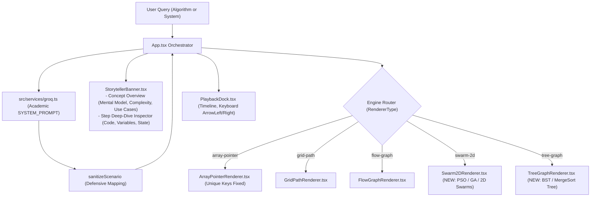

# Implementation Plan: Comprehensive Upgrade of TechViz Sandbox

**Date:** 2026-10-21  
**Author:** Principal Software Architect  
**Goal:** Upgrade TechViz Sandbox to support 5 visualization engines (adding `swarm-2d` and `tree-graph`), restore `package.json` and build configs, clean dead chaos engineering code, redesign the pedagogical explanation and live inspector panels, rewrite the Groq AI pipeline with academic rigor, and synchronize presets.

---

## Architecture Overview

---

## Task Decomposition

### Task 1: Environment Restoration, Dead Code Purge & Bug Fixes
- **Files**:
  - `package.json` (CREATE)
  - `vite.config.ts`, `tsconfig.json`, `tailwind.config.js`, `postcss.config.js`, `index.html` (CREATE to ensure standard build capability)
  - `src/components/ChaosNodeControls.tsx` (DELETE)
  - `src/components/TechSwitch.tsx` (DELETE)
  - `src/components/ArrayPointerRenderer.tsx` (MODIFY: fix React key `key={`val-${value}-${idx}`}`)
  - `src/App.tsx` (MODIFY: verify / reinforce `ArrowLeft` / `ArrowRight` keyboard listener; remove orphaned `activeNodeIds` references)

### Task 2: Types & Engine Expansion (`swarm-2d` and `tree-graph`)
- **Files**:
  - `src/types/simulation.ts` (MODIFY: update `RendererType`, add `SwarmParticle`, `SwarmStepData`, `TreeNodeItem`, `TreeStepData`, `AcademicOverview`, extend `SimulationStep` & `SimulationScenario`)
  - `src/components/Swarm2DRenderer.tsx` (CREATE: 2D coordinate space, global best target pulsing ripple, Framer Motion animated particles, velocity vectors, fitness badges, status summary)
  - `src/components/TreeGraphRenderer.tsx` (CREATE: multi-level hierarchical tree layout, SVG connecting links, active/visiting/visited states, Framer Motion node transitions)
  - `src/App.tsx` (MODIFY: integrate `Swarm2DRenderer` and `TreeGraphRenderer` into visualization switch)

### Task 3: Redesign Knowledge & Step Inspector (`StorytellerBanner.tsx`)
- **Files**:
  - `src/components/StorytellerBanner.tsx` (REWRITE:
    - Section 1: Concept Overview with 3 academic pillars: Core Concept & Mental Model, Complexity & Theory, Real-world Use Cases.
    - Section 2: Step Deep-Dive Inspector with Step explanation, `logicCode` formula/pseudo-code box, `stateVariables` badges).

### Task 4: Academic Rewrite of `SYSTEM_PROMPT` & Sanitizer in `groq.ts`
- **Files**:
  - `src/services/groq.ts` (MODIFY:
    - Replace dumb-down rules with University Professor persona (CLRS, DDIA).
    - Guide classification across 5 `visualizationType`s.
    - Mandate `academicOverview` (mentalModel, complexityOrPrinciple, useCases).
    - Mandate 5-8 steps with `title`, `explanation` (what & why), `logicCode`, `stateVariables`, and `visualData`.
    - Remove hardcoded GA/PSO keyword hijack to array-pointer.
    - Update `sanitizeScenario` to preserve all new fields for `swarm-2d` and `tree-graph`).

### Task 5: Presets Synchronization & Verification
- **Files**:
  - `src/data/geneticAlgorithmPreset.ts` (MODIFY: convert to 2D Swarm / GA with particles, coordinates, target fitness, `academicOverview`, `logicCode`, `stateVariables`).
  - `src/data/morePresets.ts` (MODIFY: update `mergeSortScenario` to utilize `tree-graph` or rich step data, update presets with `academicOverview`).
  - `src/data/presets.ts` (MODIFY: update Kafka, Redis, RAG with rich `academicOverview`, `logicCode`, `stateVariables`).
  - `src/data/arrayPresets.ts` (MODIFY: update QuickSort and Binary Search with `academicOverview`).
  - `src/data/gridPresets.ts` (MODIFY: update A* with `academicOverview`).

---

## Verification Criteria
- `npm run build` (or `npx tsc --noEmit`) passes with zero TypeScript compile errors.
- All 5 visualization engines render correctly when activated.
- Arrow keys navigate steps without triggering when typing in inputs.
- Duplicate numbers in arrays render without React duplicate key warnings.
- Presets show rich academic overview and step deep-dive inspection.
